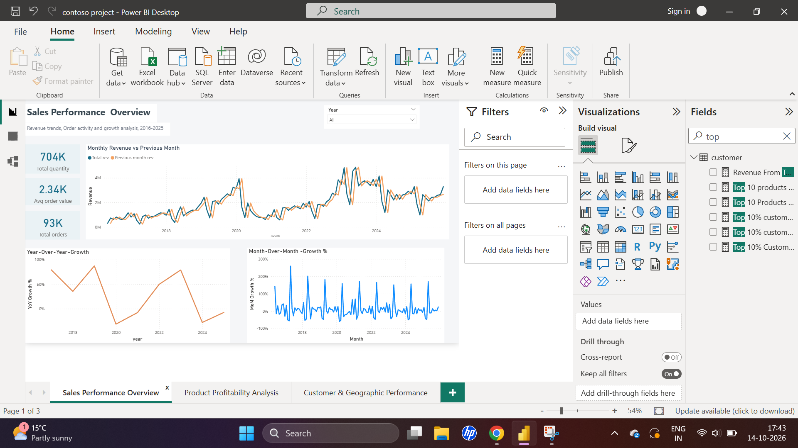
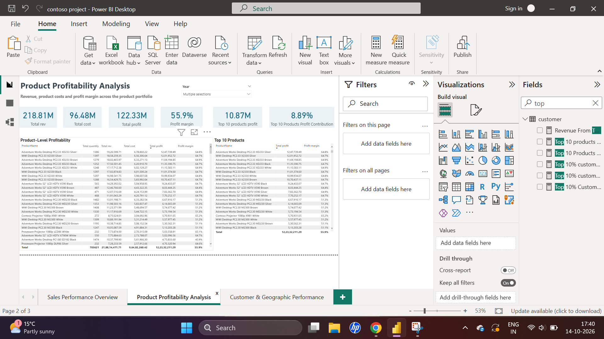
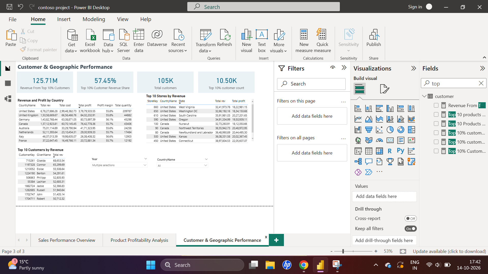

*Contoso Sales & Profitability Analysis | Power BI

*Project Overview

This project uses Power BI to analyse sales, product profitability, customer performance, and geographic trends using the Contoso dataset. The goal was to turn raw data into useful business insights through data cleaning, data modelling, DAX measures, and interactive dashboards.

*Tools Used

- Power BI Desktop
- Power Query
- DAX
- Data modelling and visualisation

*Data Preparation and Modelling

- Cleaned the data and corrected data types in Power Query.
- Handled missing store status information and corrected customer ZIP code data types.
- Built a star schema connecting Sales with the Product, Customer, Store, and Date tables.
- Created DAX measures to analyse revenue, cost, profit, margin, and sales growth.

*Dashboard Pages

1. Sales Performance Overview

- Total revenue, quantity sold, and average order value
- Monthly revenue compared with the previous month
- Month-over-month and year-over-year growth

2. Product Profitability Analysis

- Revenue, cost, profit, and profit margin
- Product-level profitability
- Top 10 products by profit and their contribution to total profit

3. Customer & Geographic Performance

- Customer revenue and concentration
- Sales by country
- Top 10 customers and stores by revenue

*Key Findings

- Total revenue was approximately 218.81 million, with total profit of 122.33 million and a profit margin of 55.91%.
- The top 10 products contributed approximately 8.89% of total profit across the full reporting period.
- The top 10% of customers accounted for approximately 57.45% of revenue, showing that a relatively small customer group generated a large share of sales.
- Monthly and year-over-year comparisons help identify changes in sales performance over time.

**Figures reflect the report's current calculations and filters. Currency denomination should be confirmed before assigning a currency symbol.

*What I Learned

This project helped me practise data cleaning, star-schema modelling, DAX calculations, time-based comparisons, and building interactive Power BI reports. It also gave me experience presenting sales and profitability findings in a business-focused format.

*Project Scope

The report covers sales from 18 May 2016 to 31 December 2025. Profit is calculated as revenue minus product cost; it does not represent net profit after operating expenses.

Author
Keerthan DS

 *Dashboard Preview

1. Sales Performance Overview

2. Product Profitability Analysis

3. Customer & Geographic Performance

